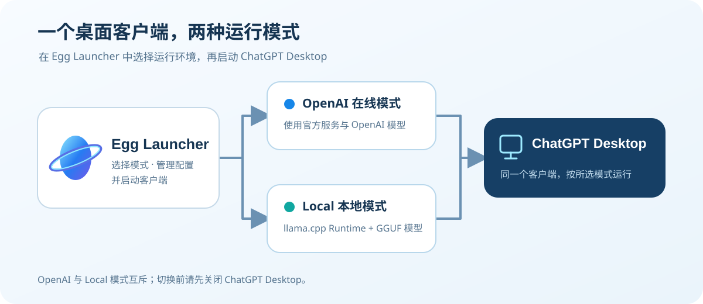

# Egg Launcher

> 一款 Windows x64 启动器，让你在同一个 ChatGPT Desktop 中切换 OpenAI 在线模式与本地 llama.cpp 模式。
>
> A Windows x64 launcher for switching between OpenAI and local llama.cpp modes in ChatGPT Desktop.

**[下载 v0.9.9（Windows x64）](https://github.com/jiazong-hub/Egg-Launcher/releases/download/v0.9.9/Egg-Launcher-0.9.9-Setup-win-x64.exe)** · [发布说明与全部文件](https://github.com/jiazong-hub/Egg-Launcher/releases/tag/v0.9.9) · [SHA-256 校验文件](https://github.com/jiazong-hub/Egg-Launcher/releases/download/v0.9.9/Egg-Launcher-0.9.9-Setup-win-x64.exe.sha256) · [用户指南](docs/user-guide.md)



开发者：甲总不是贾总 · [MIT License](LICENSE)

## 当前发布状态

- **0.9.9 发布日期为 2026-10-20。** 增加五种 n-gram 策略及 MTP 组合、实验性自定参数、资源重新检测和最近一次草稿接受率；补齐运行参数、整数 K 输入及参数说明。见[发布说明](docs/release-notes-0.9.9.md)、[发布检查](docs/release-checks-0.9.9.md)和[实现说明](docs/development-0.9.9.md)。
- 用户确认最新 0.9.9 测试包较稳定，并授权发布。全套自动化测试为 894 项；另有整数 K 输入、参数提示与接受率界面隔离检查。正式包从提交后源码重新执行发布门禁，具体结果以[发布检查](docs/release-checks-0.9.9.md)和包内 `BUILD-INFO.txt` 为准。
- Windows 10 下 CUDA、Vulkan、CPU 后端已有用户稳定性反馈；0.9.7 安装、升级、卸载恢复及思考、工具执行有历史实测。上述结论不等于 0.9.9 已通过全部安装故障与硬件矩阵。Windows 11、ROCm 尚未测试。
- 安装包沿用作者自签名证书，不属于 Windows 公共信任证书，首次运行可能出现安全提示。请核对[签名策略与证书指纹](docs/signing-policy.md)。[0.9.8](https://github.com/jiazong-hub/Egg-Launcher/releases/tag/v0.9.8)保留供回退。

## 主要功能与边界

- 模型推理由 llama.cpp 负责；启动器管理路径、模式切换、参数生成和进程协调，不保存另一套对话，不读取或替换账户凭据。
- 每个模型可以保存多套完整参数 JSON，配置与模型身份、类型绑定。保存、另存、载入仅限 `llama.cpp/scripts/profiles/configurations/<模型ID>` 的直属 JSON。
- “保存”写回当前文件并关闭参数窗口；“应用”保存并设为该模型的启动配置，保持窗口打开。卡片菜单可只改变启动配置，二者同步；改变配置预选不会选中模型卡片或立即启动模型。
- 模型卡片依次提供模型管理、启动配置、运行参数；运行模型的三个入口禁用。配置目录按用户操作刷新，删除预选后显示“无”，不自动选择替代文件，新启动会再次读取并校验。
- 模型管理集中提供模型信息、模型类型、模板、MTP 文件和视觉模块五页。模型显示名称只用于展示；类型变更不改写已有 JSON，类型不同的配置不能载入或新启动。
- 模板与外挂登记和能力依据独立保存，各 JSON 可以选择不同的已登记资源。模板仅接受 `scripts/templates` 直属 `.jinja`；外挂移除只取消登记，不删除文件，仍被配置引用时拒绝移除。
- 验证范围保持原实现：模板执行渲染检查，外置 MTP 执行隔离联合加载与极短推理，视觉采用 GGUF 元数据识别及 Runtime 选项检查；不宣称完成图片推理验证。内置 MTP 继续由正式加载确认。
- JSON 保存完整参数；未设置的可选参数仍由生成规则省略。保存不改 BAT、Catalog、Router preset 或 Codex 配置；新启动按预选快照重新生成运行文件并事务应用。运行中服务复用及恢复使用已应用快照。
- 本地模式的 OpenAI 认证是全局设置，默认关闭，保存于启动器 `settings.json`，不写入模型 JSON。客户端或本地服务运行时禁止切换，下次本地启动生效；关闭后客户端可能不显示账户与额度信息，项目历史仍可查阅。
- 思考检测留在思考页；有效结果可供同模型、相同依据的配置复用。开关、档位、默认档位和显示偏好分别管理，只提供已确认的原始档位，不补齐或映射。
- OpenAI 与 Local 模式互斥，切换前须关闭客户端。Local 模型 A 可直接切到 B。切回在线或卸载时独立恢复官方受管配置，不依赖当前 JSON 是否存在。
- 两种模式共享项目和历史，可跨模式查阅；不承诺在另一 Provider 下继续原任务，继续开发时在目标模式创建新任务。认证开关不会迁移会话文件或改变此边界。
- Codex 负责 token 监控、摘要和历史重建；llama.cpp 管理硬 Context 与原生滚动。启动器只设置 `Context - 安全余量` 作为本地压缩线，不限制单次输出，也不把本地压缩值应用到在线模式。
- 上下文、压缩安全余量和工具结果历史上限统一直接输入整数 K（1K=1,024 tokens）；JSON 和传给引擎的实际数值仍为 tokens，旧配置不静默取整。
- 推测解码支持五种 n-gram 策略与 MTP 组合；具体支持及性能由运行库与模型决定。扩展固定参数按 Dense/MoE 和已启用功能生成，不保证启用后一定提速。
- 实验性自定参数区分 llama.cpp 参数与 Codex TOML 键值。保存、应用、另存拒绝固定参数覆盖、重复命令和已知别名冲突；Codex 自定项通过既有配置事务应用和恢复。
- 模板、MTP 与视觉资源支持原路径重新检测；检测排除无关配置，登记不因启动器升级、时间或无关参数自动失效。视觉仍是元数据识别，不扩大为图片推理验证。
- 仪表盘显示速度、接受率、上下文。接受率只搬运最近一次 llama 原生请求统计，无新结果时保留；无数据、未启用 MTP、停止服务或切回在线显示短横线。MTP+n-gram 的整体接受率不会标作 MTP 独立接受率。
- 简易日志记录关键结果、拦截和错误；详细日志增加阶段、耗时及异常栈。配置、资源、启动、认证与恢复均纳入现有日志机制，不逐次记录悬停或参数输入；日志失败不影响业务。
- 支持明暗主题、中英文、托盘与后台 Agent。公开模型搜索及下载仍为实验性功能；模型主文件使用 llama.cpp 原生下载，辅助文件使用受控独立下载流程。

## 使用与发布资料

- [用户功能说明](docs/user-guide.md)
- [0.9.9 发布说明](docs/release-notes-0.9.9.md)
- [0.9.9 发布检查](docs/release-checks-0.9.9.md)
- [0.9.9 实现与历史检查](docs/development-0.9.9.md)
- [0.9.8 发布说明（历史）](docs/release-notes-0.9.8.md)
- [真机验收清单](docs/manual-acceptance-checklist.md)
- [变更记录](CHANGELOG.md)
- [0.9.7 发布检查（历史）](docs/release-checks-0.9.7.md)
- [架构决策 0002：薄管理壳](docs/architecture/0002-thin-launcher-boundary.md)
- [架构决策 0003：配置沙箱权限](docs/architecture/0003-per-model-codex-sandbox.md)
- [架构决策 0004：跨模式历史边界](docs/architecture/0004-cross-provider-history-boundary.md)

## 开发环境

- Windows 10 22H2 x64（Build 19045）或 Windows 11 x64
- .NET 10 SDK

仓库可使用项目内 SDK：

```powershell
& '.\.tools\dotnet\dotnet.exe' build '.\ChatGPTLocalLauncher.sln'
& '.\.tools\dotnet\dotnet.exe' test '.\ChatGPTLocalLauncher.sln'
```

生成 Windows x64 便携验收包：

```powershell
& '.\scripts\Publish-Portable.ps1'
& '.\scripts\Publish-Portable.ps1' -SelfContained -Archive
```

生成 Windows x64 单文件 EXE 安装包（当前用户安装）：

```powershell
& '.\scripts\Publish-Installer.ps1' -IsccPath 'C:\Program Files (x86)\Inno Setup 6\ISCC.exe'
```

编译器须安装 Inno Setup 6.5 或更新版本；简体中文语言文件已随项目放在 `installer/ChineseSimplified.isl`（来源：Inno Setup 官方翻译仓库）。脚本复用便携发布门禁，先生成自包含内部目录，再编译安装包与 `.sha256` 文件。没有签名参数时仅供内部验收，不作为公开发布包。正式签名需要 PowerShell 7（`pwsh.exe` 位于 PATH），并传入 `-RequireSignature -SigningCertificateThumbprint '证书指纹'`；若使用自签名证书，另加 `-AllowUntrustedSelfSignedCertificate`。可选传入 `-SignToolPath` 和 `-TimestampUrl`，安装包与卸载程序由同一签名命令签署。

安装器默认使用当前用户的程序目录，不要求管理员权限；不自动启用登录启动，不安装 llama.cpp、模型或 ChatGPT Desktop。升级前应正常退出启动器和 Agent。卸载确认后会先检查 ChatGPT Desktop 是否已关闭，并在必要时通过现有事务恢复 OpenAI 配置；失败会停止卸载。旧 Local 任务所需的未激活历史 Provider、`%LOCALAPPDATA%\ChatGPTLocalLauncher` 数据、模型和 Runtime 目录仍保留。旧便携版文件不会被自动删除。

使用已安装在当前用户证书存储中的可信代码签名证书发布：

```powershell
& '.\scripts\Publish-Portable.ps1' -SelfContained -Archive -RequireSignature `
    -SigningCertificateThumbprint '证书指纹' `
    -SignToolPath 'C:\Program Files (x86)\Windows Kits\10\bin\<版本>\x64\signtool.exe' `
    -TimestampUrl 'https://你的时间戳服务地址'
```

开源项目使用自签名作者证书发布时可省略 `SignToolPath`，直接使用 Windows PowerShell Authenticode：

```powershell
& '.\scripts\Publish-Portable.ps1' -SelfContained -Archive -RequireSignature `
    -AllowUntrustedSelfSignedCertificate `
    -SigningCertificateThumbprint '证书指纹'
```

首次证书初始化使用 `scripts\Initialize-SelfSignedCodeSigning.ps1`，并把 PFX 私钥备份到源码目录之外。自签名可以省略外部时间戳；证书过期后需要使用同一私钥续签或重新签署发布文件。自签名只证明持有同一私钥的作者身份连续性和签名后文件完整性；项目应在官方源码及发布页面长期公开证书指纹，不能把它描述为第三方身份认证或 Windows 公共信任。

签名在生成哈希清单和 ZIP 之前执行；脚本会逐个验证 Launcher 自有 EXE/DLL 的 Authenticode 签名。未提供签名参数时仍可生成内部验收包，但 `BUILD-INFO.txt` 会明确记录 `Signature=unsigned`；正式对外公测应使用 `-RequireSignature`，缺少任一签名条件都会拒绝发布。

发布脚本使用锁定依赖，依次执行 Release 警告门禁、格式检查、全部测试、在线依赖漏洞审计和发布后 Agent 自检。默认生成带 UTC 时间戳的新目录，不覆盖旧包；ZIP 会解压并逐文件比对哈希。只有明确的离线验收才可使用 `-SkipDependencyAudit`，该状态会写入 `BUILD-INFO.txt`。

真实客户端验收必须安排在可以完全关闭 ChatGPT Desktop 的时间，按 [真机验收清单](docs/manual-acceptance-checklist.md) 执行。

不要根据固定文件名判断哪个包最新；每次发布都会生成新的版本化目录和 ZIP。同目录 `.sha256` 文件用于校验整个下载包，包内 `BUILD-INFO.txt` 和 `SHA256SUMS.txt` 分别记录源码摘要、门禁结果及逐文件哈希。真实 Desktop Local 请求仍需真机复测。

隔离 Smoke Test（会加载 `D:\llama.cpp\models` 中识别到的第一个主模型）：

```powershell
& '.\.tools\dotnet\dotnet.exe' run --project '.\src\Launcher.Agent\Launcher.Agent.csproj' -- --smoke-codex 'D:\llama.cpp' --once
& '.\.tools\dotnet\dotnet.exe' run --project '.\src\Launcher.Agent\Launcher.Agent.csproj' -- --smoke-codex-tools 'D:\llama.cpp' --once
& '.\.tools\dotnet\dotnet.exe' run --project '.\src\Launcher.Agent\Launcher.Agent.csproj' -- --smoke-codex-compaction 'D:\llama.cpp' --once
```

第一条验证 Codex 文本端到端链路；第二条是严格工具门，分别报告工具调用次数、成功次数和策略拒绝次数。策略拒绝表示测试环境未授权，不能误报为 llama.cpp 连接故障；只有 JSONL 中出现成功的命令执行事件才通过。第三条只降低本次测试的阈值，验证 Codex 通过普通 `/responses` 摘要轮次完成本地自动压缩，且没有误走 llama.cpp 不支持的远程压缩协议。

## 项目结构

- `Launcher.App`：WPF 图形界面
- `Launcher.Agent`：Local 会话的后台协调进程及卸载准备入口
- `Launcher.Core`：设置、状态与持久化
- `Launcher.Runtime`：llama.cpp Runtime / Router 能力探测、进程管理与回环安全代理
- `Launcher.Models`：GGUF 扫描、公开模型目录元数据与 Profile
- `Launcher.Scripts`：BAT 与 Router preset 生成
- `Launcher.ChatGPT`：ChatGPT Desktop 集成、备份与恢复边界
- `Launcher.Orchestration`：模式切换事务与后台 Router 监督
- `Launcher.Tests`：自动化测试
- `docs/user-guide.md`：页面、按钮、参数、状态与对话框说明
- `docs/release-notes-0.9.1.md`：v0.9.1 公测版封存说明
- `docs/release-notes-0.9.2.md`：v0.9.2 本地版本范围和已知限制
- `installer/EggLauncher.iss`：EXE 安装与卸载脚本
- `scripts/Publish-Installer.ps1`：安装包发布门禁与签名编译入口
- `docs/research`：历史探索记录，不作为当前实现规范

## 安全原则

不读取或复制 `auth.json` 内容；不整目录覆盖 `.codex`；不按进程名批量终止 llama-server；不在代理中实现模型能力或改写对话语义；所有真实 Provider 切换都要求客户端已关闭并由用户明确确认。登录启动只接受不允许普通用户组修改的 Launcher 程序位置。启动 llama 子进程前会移除常见云端 API key/token 环境变量；原生 stdout/stderr 日志每段上限为 16 MiB，停止后保留至多 10 个文件，但其内容由 llama.cpp 决定，排障后应按需清理。自动化构建与封存不会修改用户的真实 ChatGPT Provider；真实模式切换由用户按验收清单执行。

当前实现边界见 [架构决策 0002：Launcher 保持为 llama.cpp 的薄管理壳](docs/architecture/0002-thin-launcher-boundary.md)。`docs/research` 中的早期实测记录仅用于追溯，里面已经废弃的兼容代理方案不是当前实现依据，也不会放入发布包。
